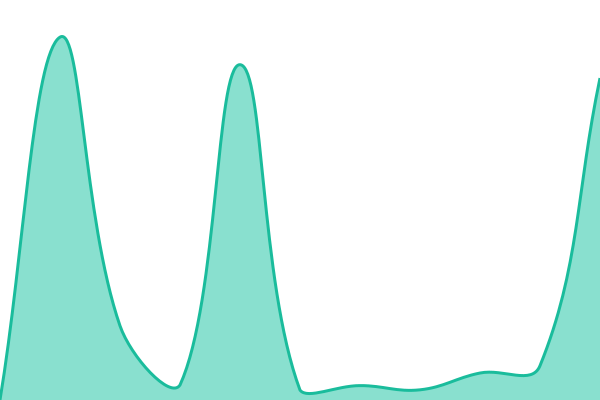
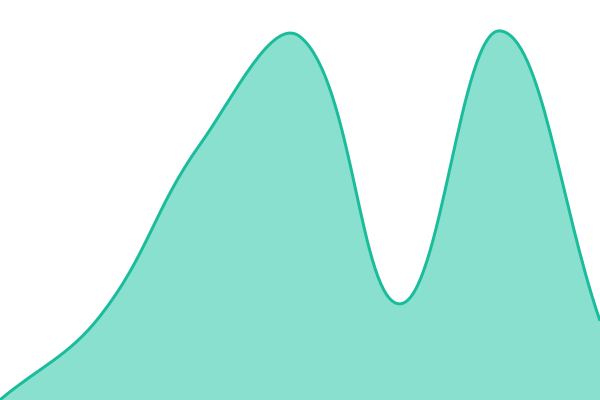
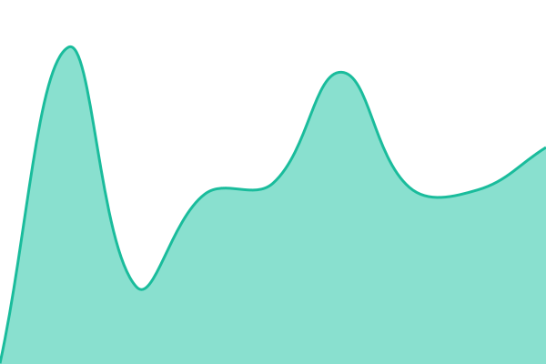
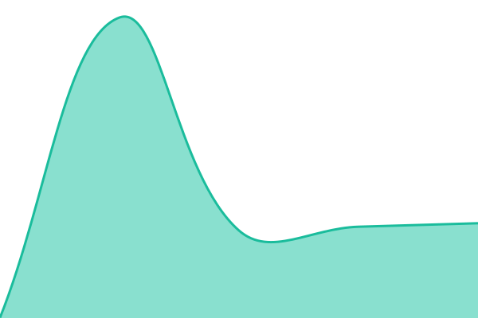

# [📈 Live Status](https://status.samplerealm.com): <!--live status--> **All systems operational**

This repository contains the open-source uptime monitor and status page for [Nick Morgan](https://status.samplerealm.com), powered by [Upptime](https://github.com/upptime/upptime).

With [Upptime](https://upptime.js.org), you can get your own unlimited and free uptime monitor and status page, powered entirely by a GitHub repository. We use [Issues](https://github.com/nmorgan94/samplerealm-status/issues) as incident reports, [Actions](https://github.com/nmorgan94/samplerealm-status/actions) as uptime monitors, and [Pages](https://status.samplerealm.com) for the status page.

<!--start: status pages-->
<!-- This summary is generated by Upptime (https://github.com/upptime/upptime) -->
<!-- Do not edit this manually, your changes will be overwritten -->
<!-- prettier-ignore -->
| URL | Status | History | Response Time | Uptime |
| --- | ------ | ------- | ------------- | ------ |
|  [Website](https://samplerealm.com) | 🟩 Up | [website.yml](https://github.com/nmorgan94/samplerealm-status/commits/HEAD/history/website.yml) | 

 1169ms
     
 | 

<a href="https://status.samplerealm.com/history/website">100.00%</a>
    

|  [Plugin catalogue](https://samplerealm.com/api/health?check=catalogue) | 🟩 Up | [plugin-catalogue.yml](https://github.com/nmorgan94/samplerealm-status/commits/HEAD/history/plugin-catalogue.yml) | 

 2408ms
     
 | 

<a href="https://status.samplerealm.com/history/plugin-catalogue">100.00%</a>
    

|  [Installer downloads](https://samplerealm.com/api/health?check=installers) | 🟩 Up | [installer-downloads.yml](https://github.com/nmorgan94/samplerealm-status/commits/HEAD/history/installer-downloads.yml) | 

 360ms
     
 | 

<a href="https://status.samplerealm.com/history/installer-downloads">100.00%</a>
    

|  [Licence activation](https://samplerealm.com/api/health?check=licences) | 🟩 Up | [licence-activation.yml](https://github.com/nmorgan94/samplerealm-status/commits/HEAD/history/licence-activation.yml) | 

 386ms
     
 | 

<a href="https://status.samplerealm.com/history/licence-activation">100.00%</a>
    

<!--end: status pages-->

[**Visit our status website →**](https://status.samplerealm.com)

## 📄 License

- Powered by: [Upptime](https://github.com/upptime/upptime)
- Code: [MIT](./LICENSE) © [Anand Chowdhary](https://anandchowdhary.com)
- Data in the `./history` directory: [Open Database License](https://opendatacommons.org/licenses/odbl/1-0/)
